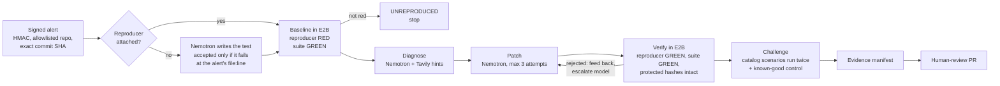

# PatchWarden

**An incident-response agent that ships a fix only after it proves it, and then hunts for the
bug nobody reported.**

PatchWarden takes a crash alert, reproduces the failure in an isolated E2B sandbox, has NVIDIA
Nemotron (on Nebius Token Factory) write the fix, and opens a human-review pull request only after
trusted checks prove it. The model proposes; trusted code decides. Nothing in the run log, the
evidence file or the PR is taken from model output on trust.

| | |
|---|---|
| **Live demo** | https://p01--patchwarden-api--smbsdvp245v8.code.run/ui/ (no login) |
| **Video (3 min)** | _YouTube link added before submission_ |
| **PRs it opened** | https://github.com/Satyabratadas/patchwarden-demo/pulls |
| **Results** | [`docs/evaluation.md`](docs/evaluation.md): 32 live runs, 0 false positives |
| **Track** | Coding and Agentic Engineering |

## Try it in one minute

1. Open the [live demo](https://p01--patchwarden-api--smbsdvp245v8.code.run/ui/) and press
   **Run live** on alert **07** (it carries only a stack trace, no test).
2. Watch the timeline:
   - `Sandbox ready: e2b (sandbox …; network allowed only to pypi.org, …)`
   - `Model-written reproducer accepted: fails with ValidationError at demo_app/app/main.py:14`
   - `Baseline red … (reproducer: 1 failed); suite green (3 passed)`
   - `Reproducer green (1 passed), original suite green (3 passed), protected files unchanged`
   - `Confirmed a second defect: retry_same_key`, a double charge no alert mentioned
   - `Opened human-review PR https://github.com/Satyabratadas/patchwarden-demo/pull/…`
3. Open the PR: it holds the fix **and** the regression test the model wrote, plus the evidence.

Live runs are capped per day. When they are used up, open a recorded run from the same page:
the [headline run](https://p01--patchwarden-api--smbsdvp245v8.code.run/ui/?replay=recordings/run-376fefbdfc1a.json),
a [stack-trace-only alert](https://p01--patchwarden-api--smbsdvp245v8.code.run/ui/?replay=recordings/run-4e9997e40534.json),
or the [model ladder escalating](https://p01--patchwarden-api--smbsdvp245v8.code.run/ui/?replay=recordings/run-6f018665190c.json).

## What makes it different

- **Proof before PR.** A fix counts only if, in a fresh sandbox at the pinned commit, the failing
  test turns green, the original suite stays green, and no protected test file changed.
- **Writes its own reproducer.** Given only a stack trace, Nemotron writes the failing test.
  Trusted code accepts it only if it crashes at the exact `file:line` the alert names, then locks
  it so no patch can weaken it.
- **Finds the bug nobody reported.** After the fix, the model picks challenge scenarios from a
  human-written catalog. A violation is reported only if it repeats **and** the same scenario
  passes on a known-good control, so the agent does not cry wolf.
- **The verifier picks the model.** Nemotron Nano writes the first patch; only a patch that fails
  verification escalates the run to Super, then Ultra.

## Built with

| Piece | Role |
|---|---|
| **NVIDIA Nemotron 3** (Super; Nano and Ultra in the ladder) | Writes the reproducer, diagnoses, writes the patch, picks challenge scenarios |
| **Nebius Token Factory** | Serves Nemotron through its OpenAI-compatible API, with retries, timeouts and token caps |
| **Tavily** | Searches docs for the observed error; results are untrusted hints, cited in the PR |
| **E2B** | Runs every command that executes repository code, in a microVM that can reach only PyPI |
| **GitHub API** | Commits the verified files on the pinned commit and opens a PR; never merges |
| FastAPI, SQLite, pytest | Signed webhook, append-only event log, the tests that decide every gate |

### How we use Nemotron on Token Factory

- **Every run calls Token Factory at runtime, 3 to 5 times** (more when a patch is retried): write
  the reproducer (when the alert has none), diagnose, patch, pick challenge scenarios, and
  optionally repair the second defect.
- **Three Nemotron models, measured** on the same cases: Super (default), Ultra (550B) and Nano
  (30B) all verified 6/6 incidents with 0 false positives.
- **Verifier-driven ladder** (`NEBIUS_PATCH_MODELS`): on the six cases, Nano's patch was enough in
  3; the verifier escalated the other 3 to Super; Ultra was never needed.
- **Where Token Factory sped us up:** the stock `openai` client worked unchanged, `models.list()`
  gave exact IDs, and switching models is one string, so a cross-model evaluation took an
  afternoon. Our notes and suggestions: [`docs/feedback.md`](docs/feedback.md).

## How it works



1. **Alert.** `POST /webhooks/incident` checks the HMAC signature, the repository allowlist, a
   40-character commit SHA and a known reproducer ID. A duplicate alert returns the same run.
2. **Reproduce.** A fresh E2B sandbox checks out the pinned commit. The reproducer must fail *for
   the reported error type* and the original suite must pass, or the run stops. If the alert has
   no reproducer, Nemotron writes one first (two tries; a test that raises the error itself or
   fails elsewhere is rejected). Every test file and contract is hashed.
3. **Diagnose and patch.** Nemotron sees the observed failure, the source files it names, and
   Tavily hints. It returns whole files; PatchWarden builds the diff. Only application code may
   change.
4. **Verify.** Trusted code resets to the pinned commit, applies the patch, and requires the
   reproducer green, the suite green and every protected hash unchanged. A failure is fed back to
   the next attempt.
5. **Challenge.** Catalog scenarios run twice against the patched code, with a known-good
   negative control before any second defect is claimed. It is reported, or repaired and
   re-verified with `--repair-discovery`.
6. **Publish.** The evidence manifest (commit, patch and test hashes, commands and exit codes,
   models, sandbox ID, Tavily sources) is written and a PR opens for a human to review.

Trust boundaries, states and failure codes: [`docs/architecture.md`](docs/architecture.md).

## Results

32 live runs on the seeded checkout app (real Nemotron, real E2B, no cached replies). Every number is
rebuilt from the evidence files by `make evaluation`; details in [`docs/evaluation.md`](docs/evaluation.md).

| Experiment | Runs | Fix verified | Hidden double charge found | False positives |
|---|---|---|---|---|
| Six incidents, Nemotron 3 Super, PRs opened | 6 + 2 repeats | 8/8 | 7/7 seeded runs | 0 |
| Same six on Nemotron 3 Ultra | 6 | 6/6 | 4/5 | 0 |
| Same six on Nemotron 3 Nano | 6 | 6/6 | 4/5 | 0 |
| Same six, Nano → Super → Ultra ladder | 6 | 6/6 (3 escalated) | 5/5 | 0 |
| Stack-trace-only alerts 07–09, twice each | 6 | 6/6 (all tests accepted first try) | 5/6 | 0 |

The six incidents with the default model:

| Case | Reported bug | Verified | Hidden double charge | PR |
|---|---|---|---|---|
| 01 | Malformed gateway payload crashes checkout (`ValidationError`) | attempt 1 | found, reported | [#2](https://github.com/Satyabratadas/patchwarden-demo/pull/2) |
| 02 | Same crash, second repair loop on | attempt 1 | found, **repaired and re-verified** | [#3](https://github.com/Satyabratadas/patchwarden-demo/pull/3) |
| 03 | Payment held for review completes the order (logic bug) | attempt 1 | found, reported | [#4](https://github.com/Satyabratadas/patchwarden-demo/pull/4) |
| 04 | Unknown SKU crashes checkout (`KeyError`, blind) | attempt 1 | found, reported | [#5](https://github.com/Satyabratadas/patchwarden-demo/pull/5) |
| 05 | Gateway timeout crashes checkout (`TimeoutError`, blind) | attempt 1 | found, reported | [#6](https://github.com/Satyabratadas/patchwarden-demo/pull/6) |
| 06 | Same as 01 on the known-good variant (negative control) | attempt 1 | none claimed (correct) | [#7](https://github.com/Satyabratadas/patchwarden-demo/pull/7) |

Nobody told the agent about the double charge: it chose the scenario that exposes it, and trusted
code confirmed it twice and checked it against a known-good control. One fix (case 03) is correct
but narrower than a human would write, which is why every change goes to a reviewer.

## Run it locally

Requires Python 3.11 and conda. Full walkthrough: [`docs/SETUP.md`](docs/SETUP.md).

```sh
conda create -n patchwarden python=3.11 -y && conda activate patchwarden
make install                 # pinned dependencies + the package
cp .env.example .env         # add your keys; never commit .env
make test lint secrets       # offline: model, E2B, Tavily and GitHub are faked
```

Run one incident end to end (real model and E2B; opens a PR when GitHub is configured and
`OPEN_PR_ON_VERIFIED=true`):

```sh
make incident                                              # alert 01
make incident FIXTURE=demo_app/fixtures/incident_07.json   # stack trace only
```

Or the full service with the signed webhook and UI:

```sh
make run                     # API + UI on http://127.0.0.1:8000/ui/
python -m patchwarden.scripts.send_demo_alert --fixture demo_app/fixtures/incident_07.json
```

No keys at all: `python -m patchwarden.scripts.run_incident --local --mock`. Docker:
`docker build -t patchwarden . && docker run -p 8000:8000 --env-file .env patchwarden`. To offer
**Run live** on your own host, set `PUBLIC_DEMO_RUNS_PER_DAY` (needs E2B); public runs open PRs only
with `PUBLIC_DEMO_OPEN_PRS=true` and a token scoped to the demo repository.

## Project structure

```
patchwarden/            the agent service
├── orchestrator.py     the run state machine; every gate fails closed
├── agent/              Nemotron client, prompts, reproducer writer, patch loop, Tavily search
├── sandbox/            E2B microVM, pinned checkout, fixed commands
├── verifier/           baseline, patch policy, verification, evidence manifest
├── discovery/          challenge scenario catalog, trusted runner, negative control
├── api/                signed webhook, runs API, public "Run live" endpoint
├── github/             commit and open the PR (never merges)
├── reporting/          post-mortem text for the PR
├── ui/                 progress UI and recorded runs
└── scripts/            command-line tools: run an incident, send an alert, build the evaluation
demo_app/               the seeded checkout app it repairs (mirrored to patchwarden-demo)
├── app/                application code, the only place a patch may change
├── tests/              original suite and incident reproducers (protected)
├── fixtures/           the nine demo alerts
├── contracts/          behavioral invariants for the challenge stage
└── seed_variants/      disclosed defects and the known-good control
tests/                  PatchWarden's own tests (offline)
docs/
├── architecture.md     trust boundaries, states, failure codes
├── evaluation.md       every result, rebuilt from evidence
├── evaluation/         run lists, CSVs and evidence manifests behind it
├── feedback.md         Nebius Token Factory and Nemotron feedback
├── demo_script.md      three-minute video storyboard
└── SETUP.md            step-by-step setup
```

## Honest limits

- **Seeded demo app.** The target ([patchwarden-demo](https://github.com/Satyabratadas/patchwarden-demo))
  is one small checkout app with deliberate bugs, all disclosed in
  [`demo_app/seed_variants/README.md`](demo_app/seed_variants/README.md). One is hidden from the
  agent: no alert, test or comment points to it.
- **Reproducers.** Alerts 01–06 name a test that ships with the repo; alerts 07–09 carry only the
  stack trace and the agent writes the test. Writing one needs a crash with a frame in the
  repository, so logic bugs like case 03 still need a shipped test.
- **Bounded evidence.** Passing tests and invariants are evidence, not proof of correctness.
- **Small sample.** 32 runs on one app do not represent production incidents.
- **Never merges or deploys.** Every change goes through a human-reviewed PR. The sandbox can reach
  PyPI to install the demo's pinned dependencies, and nothing else.

---

Built by Satyabrata Das and Atina Ruvinova during the hackathon (first commit October 8, 2026).
Licensed under [Apache-2.0](LICENSE).
