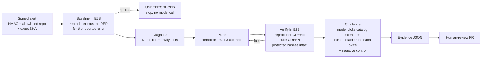

# PatchWarden

**An evidence-gated incident-response agent.** PatchWarden takes a signed crash alert, reproduces
the failure in an isolated sandbox, has an NVIDIA Nemotron model write a fix, and opens a
human-review pull request only after independent checks prove the fix. When the alert carries
only a stack trace, Nemotron first writes the failing test itself, and trusted code accepts it only
if it crashes at the exact line the alert names. PatchWarden then challenges its own patch with
human-written behavioral rules and can find a second bug nobody reported.

The model proposes; trusted code decides. No claim in the run log, the evidence file or the PR
comes from model output.

- **Live product:** https://p01--patchwarden-api--smbsdvp245v8.code.run/ui/ Press **Run live** on any of
  the alerts (07 has no reproducer attached) and watch a real run: Nemotron on Nebius, an E2B sandbox, the trusted gates, the
  verified diff and the evidence. Recorded runs replay there too. (`GET /health` shows the configuration.)
- **Headline run:** signed alert `demo-001` → PR [#8](https://github.com/Satyabratadas/patchwarden-demo/pull/8) (replay it in the UI: `/ui/?replay=recordings/run-376fefbdfc1a.json`)
- **Model ladder run:** Nano's patch is rejected by the verifier, the run escalates to Super, and the
  fix verifies (`/ui/?replay=recordings/run-6f018665190c.json`)
- **All generated PRs:** https://github.com/Satyabratadas/patchwarden-demo/pulls
- **Video (3 min):** _link added at submission_
- **Track:** Coding and Agentic Engineering
- **Try it (no login):** open the live product and press **Run live** on any alert. When the
  day's live runs are used up, open any recorded run to replay it.
- **Built during the hackathon:** first commit October 8, 2026; all code was written in the
  submission period.

## Built with

| Piece | What it does in PatchWarden |
|---|---|
| **NVIDIA Nemotron 3 Super** (`nvidia/nemotron-3-super-120b-a12b`) | Writes the reproducer test when the alert has none, diagnoses the failure, writes the patch, and picks challenge scenarios from a fixed catalog |
| **Nebius Token Factory** | Serves Nemotron through its OpenAI-compatible API (`https://api.tokenfactory.nebius.com/v1/`) with retries, timeouts and token caps |
| **Tavily** | Searches docs for the observed error; results are passed to the model as untrusted hints and cited in the PR |
| **E2B** | Runs every command that executes repository code in a microVM whose network can reach only PyPI |
| **GitHub API** | Commits the verified files onto the pinned commit and opens a PR. It never merges |
| FastAPI, SQLite, pytest | Signed webhook, append-only event log, the tests that decide every gate |

### How we use NVIDIA Nemotron on Nebius Token Factory

- **Every run calls Token Factory at runtime**, 3 to 5 times: Nemotron writes the reproducer
  when the alert ships none, diagnoses the observed failure, writes the patch (whole files; PatchWarden builds the diff), picks challenge scenarios
  from the catalog, and with `--repair-discovery` writes the second fix. Hosted runs do the same.
- **Three Nemotron models, measured.** Nemotron 3 Super is the default. Nemotron 3 Ultra (550B)
  and Nemotron 3 Nano (30B) ran the same six cases with one environment variable changed: all
  three verified 6/6 incidents with 0 false positives ([comparison](docs/evaluation.md#same-six-cases-on-other-nemotron-models)).
- **The verifier picks the model.** With `NEBIUS_PATCH_MODELS` set to a ladder such as
  Nano → Super → Ultra, the first patch attempt goes to the fast model and only a patch that
  fails the trusted checks in the sandbox moves the run up to a larger model. Escalation is
  driven by evidence, never by the model's own confidence. Live on the six cases: Nano's patch
  verified in 3, the verifier escalated the other 3 to Super, and all 6 verified with the hidden
  double charge still found in 5/5 seeded cases.
- **Where Token Factory sped us up.** The OpenAI-compatible endpoint let us use the standard
  `openai` client with retries, timeouts and token caps, and nothing provider-specific.
  `models.list()` gave exact model IDs. Switching models is one variable, which is how we reran
  the six cases on two more Nemotron models in an afternoon. Notes, issues and suggestions are in
  [`docs/feedback.md`](docs/feedback.md).

## How it works



1. **Alert.** `POST /webhooks/incident` checks the HMAC signature, the repository allowlist, a
   40-character commit SHA and a known reproducer ID. A duplicate alert returns the same run.
2. **Baseline.** A fresh E2B sandbox runs the reproducer test and the original suite at the pinned
   commit. The reproducer must fail *for the reported error type*; otherwise the run stops as
   UNREPRODUCED. Every test file, the contracts and the control gateway are hashed.
   **No reproducer in the alert?** Nemotron writes one from the stack trace and the sanitized
   request. Trusted code runs it in the sandbox and accepts it only if pytest reports the reported
   error at the exact `file:line` the alert's deepest frame names (a test that raises the error
   itself, expects it, or fails elsewhere is rejected with the reason fed back; two tries). The accepted
   test is hashed with the protected tests, so no patch can weaken it, and ships in the PR as the
   regression test.
3. **Diagnose and patch.** Nemotron sees the observed red output, the source files that output
   names (or that the failing test imports), and Tavily hints. It returns whole files; PatchWarden
   builds the diff. The patch policy allows only `demo_app/app/**/*.py`.
4. **Verify.** Trusted code resets to the pinned commit, applies the patch, and requires the
   reproducer green, the original suite green and every protected hash unchanged. A failure is
   fed back as the next attempt's input (at most three).
5. **Challenge.** The model picks scenarios from a human-written catalog (IDs and bounded
   parameters only). A trusted runner executes each one twice against the patched code. A
   violation is confirmed only if it repeats **and** the same scenario holds on a known-good
   control gateway. A confirmed second defect is reported, or repaired and re-verified with
   `--repair-discovery`.
6. **Publish.** The evidence manifest (commit, patch hash, test hashes, commands and exit codes,
   model ID, sandbox ID, Tavily sources) is written and a PR is opened for a human to review.

Details, trust boundaries and failure codes: [`docs/architecture.md`](docs/architecture.md).

## Results

Six controlled cases on the seeded checkout app, one executed run each, built from the evidence
files by `make evaluation`. Full table and method: [`docs/evaluation.md`](docs/evaluation.md).

| Case | Reported bug | Verified | Hidden double charge | PR |
|---|---|---|---|---|
| 01 | Malformed gateway payload crashes checkout (`ValidationError`) | attempt 1 | found, reported | [#2](https://github.com/Satyabratadas/patchwarden-demo/pull/2) |
| 02 | Same crash, second repair loop on | attempt 1 | found, **repaired and re-verified** | [#3](https://github.com/Satyabratadas/patchwarden-demo/pull/3) |
| 03 | Payment held for review completes the order (logic bug) | attempt 1 | found, reported | [#4](https://github.com/Satyabratadas/patchwarden-demo/pull/4) |
| 04 | Unknown SKU crashes checkout (`KeyError`, blind) | attempt 1 | found, reported | [#5](https://github.com/Satyabratadas/patchwarden-demo/pull/5) |
| 05 | Gateway timeout crashes checkout (`TimeoutError`, blind) | attempt 1 | found, reported | [#6](https://github.com/Satyabratadas/patchwarden-demo/pull/6) |
| 06 | Same as 01 on the known-good variant (negative control) | attempt 1 | none claimed (correct) | [#7](https://github.com/Satyabratadas/patchwarden-demo/pull/7) |

6/6 incidents reproduced and verified, 0 false positives. Nobody told the agent about the double
charge: it chose the scenario that exposes it on its own, and trusted code confirmed it twice and
checked it against a known-good control. One verified fix (case 03) is correct but narrower than
a human would write, which is why every change goes to a reviewer.

**Same cases on other Nemotron models.** With only the model ID changed, Nemotron 3 Ultra and
Nemotron 3 Nano also verified 6/6 incidents with 0 false positives; Nano needed the verifier's
feedback loop twice. With the Nano → Super → Ultra patch ladder, all six verified and the verifier
escalated three of them to Super. Super stays the default. See the comparison in [`docs/evaluation.md`](docs/evaluation.md#same-six-cases-on-other-nemotron-models).

**Alerts with only a stack trace.** Alerts 07–09 are three of the crashes above with no
reproducer attached. In 6 live runs (each alert twice), Nemotron's first test was accepted every
time, all 6 fixes verified, and the hidden double charge was still found in 5 of 6. Replay one:
`/ui/?replay=recordings/run-4e9997e40534.json`. Details: [`docs/evaluation.md`](docs/evaluation.md#alerts-with-only-a-stack-trace).

## Run it

Requires Python 3.11 and conda. Step-by-step setup: [`docs/SETUP.md`](docs/SETUP.md).

```sh
conda create -n patchwarden python=3.11 -y && conda activate patchwarden
make install                 # pinned deps + the package; enables the commit-msg hook
cp .env.example .env         # fill in keys locally; never commit .env
make test lint secrets       # offline: model, E2B, Tavily and GitHub are faked in tests
```

One live incident, end to end (real model, real E2B sandbox; opens a PR when `GITHUB_TOKEN` is set
and `OPEN_PR_ON_VERIFIED=true`):

```sh
make incident                                              # incident demo-001
make incident FIXTURE=demo_app/fixtures/incident_04.json   # any of the six alerts
```

The signed-webhook path, as in the demo video:

```sh
make run                                                   # API + UI on :8000
python -m patchwarden.scripts.send_demo_alert --fixture demo_app/fixtures/incident_01.json
# open http://127.0.0.1:8000/ui/?run=<run_id>
```

Offline, with no keys: `python -m patchwarden.scripts.run_incident --local --mock`, or replay a
recorded run in the UI.

To offer the **Run live** button on your own host, set `PUBLIC_DEMO_RUNS_PER_DAY` (for example
`20`) with `E2B_API_KEY` set. Public runs use only the bundled alerts, one at a time, and refuse
to start without E2B, so model-written code never runs on the web server. They open no PRs unless
you also set `PUBLIC_DEMO_OPEN_PRS=true` and `OPEN_PR_ON_VERIFIED=true` with a GitHub token scoped to
the demo repository; then each verified public run opens a human-review PR there (the hosted demo
does this). Hosted: `docker build -t patchwarden . && docker run -p 8000:8000 --env-file .env patchwarden`.

## Honest limits

- **Seeded defects.** The target app ([patchwarden-demo](https://github.com/Satyabratadas/patchwarden-demo))
  contains deliberate bugs, all disclosed in
  [`demo_app/seed_variants/README.md`](demo_app/seed_variants/README.md). One is hidden from the
  agent: no alert, test or comment points to it.
- **Reproducers.** Alerts 01–06 name a reproducer test that ships with the repo. Alerts 07–09 carry
  only the stack trace and the agent writes the test; the writing prompt never shows the shipped
  incident tests, but they are still in the demo repo. Writing a reproducer needs a crash with a
  stack frame in the repository, so logic bugs like case 03 still need a shipped test.
- **Bounded evidence.** Passing tests and invariants are evidence, not proof of correctness.
- **Small sample.** Six cases, one run each, on one small app. They do not represent production bugs.
- **Never merges or deploys.** Every change goes through a human-reviewed PR.
- The sandbox can reach PyPI to install the four pinned demo dependencies; nothing else.

## Repository map

| Path | Purpose |
|---|---|
| `patchwarden/orchestrator.py` | State machine and gates |
| `patchwarden/agent/` | Nebius client, prompts, bounded context, patch loop, Tavily |
| `patchwarden/sandbox/` | E2B lifecycle, pinned checkout, fixed commands |
| `patchwarden/verifier/` | Baseline, patch policy, verification, evidence manifest |
| `patchwarden/discovery/` | Scenario proposals, trusted catalog, runner, recheck and negative control |
| `patchwarden/api/`, `ui/` | Signed webhook, run and event API, progress UI |
| `demo_app/` | The seeded checkout app (mirrored to the demo repo), alerts in `fixtures/` |
| `docs/` | Architecture, evaluation, demo script, Nebius/NVIDIA feedback |

Built by Satyabrata Das and Atina Ruvinova, October 2026. Apache-2.0.
